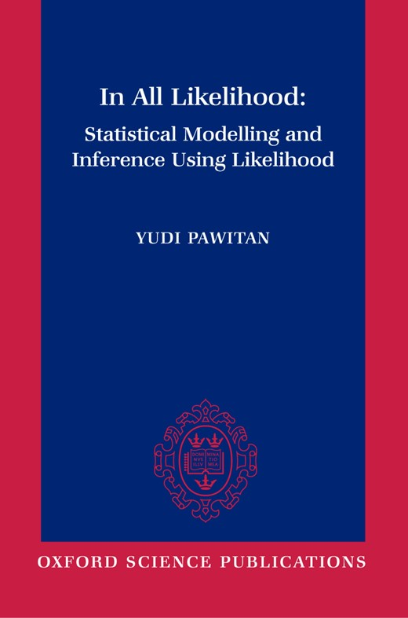

# In All Likelihood: R examples in Python



Python versions, as Jupyter notebooks, of the R code that accompanies
Yudi Pawitan, *In All Likelihood: Statistical Modelling and Inference Using
Likelihood* (Oxford University Press, 2001; ISBN 9780198507659).

- Book: [publisher's page at Oxford Academic](https://academic.oup.com/book/53921)
- Original R code and data: [the author's page for the book](https://www.meb.ki.se/sites/yudpaw/wp-content/uploads/sites/5/likelihood/likelihood-index.htm)

The R scripts and data files are the author's, and the copyright in them
remains with him. The cover image is the publisher's and is used here only to
identify the book.

<br clear="right">

## Layout

| Path | Contents |
|---|---|
| `chapterNN.ipynb` | One notebook per chapter. Each section is one R script, headed with the script's name. |
| `helpers.py` | Python versions of the shared R helpers (`li.r`, `meanlike.r`, `msmooth.r`, `binormal.r`, and `ar.sim` from `arsim.dat`), plus small stand-ins for R functions such as `approx`, `scan`, `cut`, `qqnorm` and `density`. |
| `data/` | The data files, unchanged. Some (`exercise*.dat`) are not used by any script. |
| `R/` | The original R scripts, unchanged. |

There is no R code for chapters 7 and 14, so there are no notebooks for them.

## Running

```sh
python -m venv .venv
source .venv/bin/activate
pip install -r requirements.txt
jupyter lab
```

Run the notebooks from the repository root so that `helpers.py` and `data/`
are found. The notebooks are committed with their outputs, so you can also
read them on GitHub without running anything.

## How the conversion was done

The conversion was done by Claude (Anthropic's AI model, Claude Opus 5.5,
working in Claude Code), at the request of the repository owner. Claude read
all of the R scripts and helpers, translated each script into a notebook
section, and ran every notebook from top to bottom to check that it works.

The aim was a faithful translation, edited only for readability. Nothing has
been added to the original code: in particular there are no worked answers
to the book's exercises. Comments in the R code are kept, either as code
comments or as text above each section.

Results were checked against the R code and the book where possible. For
example:

- the exact profile likelihood in Example 17.6 reproduces the values that
  are hard-coded in `EX17-6A.R` to 9 decimal places;
- the Weibull versus exponential LRT in Example 11.6 is 44.76, against 44.8
  in the R comment;
- the smoothing estimates in Chapter 18 match the values in the plot titles
  (λ̂ = 6.2 and 99.2 in Example 18.3, σ̂²_b ≈ 0.042 and 0.017 in Example 18.10
  and Figure 18.11).

The translation has not been checked line by line against R output, because R
was not run. If you find a discrepancy, please open an issue.

## Differences from the R code

### Libraries

- `lm()` and `glm()` are replaced by `statsmodels`; `coef_table()` in
  `helpers.py` prints the equivalent of `summary(fit)$coef`.
- `nlm()` is replaced by `scipy.optimize.minimize`.
- Some R functions have no exact Python equivalent:
  - `supsmu()` (Chapter 15) is replaced by `lowess`.
  - `loess()` (Example 18.1) is replaced by `lowess`, which is locally linear
    rather than quadratic.
  - `survreg()` (Example 11.6) is replaced by maximising the same censored
    exponential and Weibull log-likelihoods directly.
  - `coxph()` and `survfit()` are replaced by statsmodels' `PHReg` and
    `SurvfuncRight`.
  - `ksmooth()` (Figure 18.3) and `density()` are written out in a few lines.

### Random numbers

Random numbers come from numpy, so simulated results (bootstrap intervals,
Monte Carlo P-values, simulated data sets) differ from R's. Where a script sets
a seed, the same number is used as the numpy seed.

### Plots

The plots follow the R figures (line types, panel layout, titles) but are
drawn with matplotlib. R fixes a plot's axes from the first thing drawn, so
curves added later can run off the edge; matplotlib rescales to fit
everything. Where that made a difference, the notebooks keep R's axis limits.

### Fixes needed to run

A few scripts needed small fixes, each marked with a comment:

- variables defined in other scripts (`x0` in `EX6-7C.R`, `sumx` in
  `FIG11-6.R`, `npar` in `FIG18-9.R`);
- a hard-coded path (`d:/classes/statcomp/geyser.dat`) in `EX18-10.R`;
- a typo (`t  itle`) in `EX4-16.R`;
- the likelihood functions in `EX17-6A.R`, which never return their value,
  so `nlm()` could not have worked as written.

### Kept as written

Everything else follows the R code as written, including a few lines that
look like slips in the original:

- `1 - pnorm(chi2, 11)` in `EX4-3.R` (probably meant to be `pchisq`);
- `sigma` taken as a variance in `EX6-19A.R` (`EX6-19B.R` takes the square
  root);
- `se <- sqrt(se)` and `x <- 6` in `FIG10-3.R` (the plot title says 5/15);
- `lm(y ~ lx + lx^2)` in `EX6-18B.R`, which in R is a straight-line fit,
  because `lx^2` in a formula means `lx`.

### Script headings

A few script names don't match their own headings, and the notebooks keep the
script names:

- `EX3-9.R` is headed "Section 9-10" and is the same as `SEC9-10A.R`;
- `EX6-12.R` is headed "Example 6.6" and repeats it with a full summary;
- `EX11-6.R` is headed "Example 10.6";
- `EX17-11B.R` is headed "Exercise 18.11: Figure 17.4".

### Files not converted

The editor backup files in `R/` (`*.$$$`, `EX11-11.$R`) are older copies of
the scripts. They are not converted and not tracked in git.
